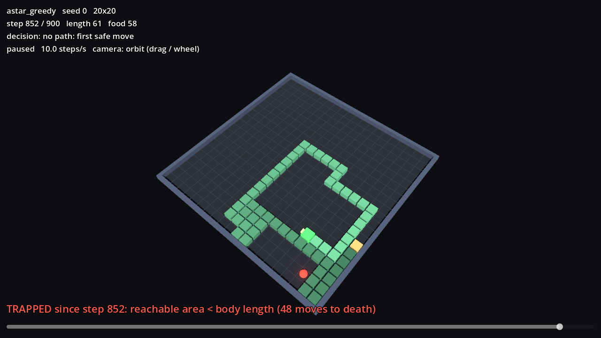

# FlySnake3D

**Can evolutionary optimisation of a real fruit-fly connectome produce a Snake controller that outperforms A\* once the snake is long enough for greedy pathfinding to trap itself?**

This is a research project, not a game demo. The controller is the **FlyWire whole-brain connectome**: 138,639 neurons and 15.1 M connections, simulated with the leaky integrate-and-fire model of Shiu et al. (2024). It is not a hand-designed neural network. Evolution adjusts a small, recorded set of parameters (sensory gains, thresholds, selected synaptic scalings, decoder gains). The wiring diagram itself stays the biological reference.

```
3D Snake ─▶ virtual eye ─▶ visual encoder ─▶ optic-lobe output neurons ─▶ connectome ─▶ descending neurons ─▶ motor decoder ─▶ snake
           (engineered)    (engineered)       (T4/T5, LPLC2, LC4 …)       (biological)   (DNa01/02, DNp01 …)   (engineered)
```

## Status

| stage | status |
|---|---|
| 0. Choose a simulator; prove the connectome can be stimulated, simulated and read | ✅ done: [report](docs/RESEARCH_REPORT_00_simulator_selection.md) |
| 1. Headless Snake core + Godot 4 replay viewer | ✅ done: [viewer](viewer/README.md) |
| 2. A\* baseline ladder (greedy → time-aware → tail check → space check) | ✅ done: [report](docs/RESEARCH_REPORT_01_astar_baselines.md) |
| 3–4. Visual encoder / motor decoder connected to the brain | |
| 5. Evolution | |
| 6–7. Experiments, analysis, dashboard | |

Headline findings from Milestone 0 (details in the report):
* The GPU simulator reproduces the published Brian2 model (per-neuron firing-rate r = 0.97).
* Looming detectors LPLC2/LC4 drive the escape giant fiber DNp01. Object detectors drive the steering neurons DNa01/DNa02 **contralaterally**.
* Direct photoreceptor stimulation **does not propagate** to the central brain in this LIF model. The retina and lamina use graded, sign-inverting signalling that the model does not capture. Visual input therefore enters at the optic-lobe output neurons.
* Cost: about 3.4 GPU-seconds per simulated brain-second. One million generations at the planned evaluation budget is about 866 years on a GTX 1660 Ti, so the plan measures learning curves over achievable budgets and extrapolates from them.

Headline findings from Stage 2: greedy A\* (the primary baseline) dies by self-trapping in 100/100 games on 20×20, mostly at length 50–100, eating 64 food on average. Adding the virtual-snake tail check raises this to 345 food (87 % of the board).



## Quick start (Milestone 0)

```bash
python -m venv ~/.venvs/flysnake3d            # keep the path short on Windows
~/.venvs/flysnake3d/Scripts/python -m pip install -r requirements.txt
~/.venvs/flysnake3d/Scripts/python -m pip install torch --index-url https://download.pytorch.org/whl/cu121
~/.venvs/flysnake3d/Scripts/python scripts/fetch_data.py      # ~140 MB, hash-checked
~/.venvs/flysnake3d/Scripts/python -m pytest
~/.venvs/flysnake3d/Scripts/python -m experiments.pathway_probe
~/.venvs/flysnake3d/Scripts/python -m experiments.retina_propagation
~/.venvs/flysnake3d/Scripts/python -m experiments.validate_backends --trials 4
~/.venvs/flysnake3d/Scripts/python -m experiments.benchmark
```

Results are written to `results/milestone0/`. The committed copies are the runs reported in the docs.

## Layout

```
brain/        connectome_loader.py, neural_simulator.py   (implemented)
experiments/  validate_backends, pathway_probe, retina_propagation, benchmark
scripts/      fetch_data.py
tests/        test_brain.py
docs/         research reports, DEVLOG, data provenance
game/ agents/ evolution/ visualization/   (later stages)
```

## Scientific framing

This is evolutionary optimisation of a *connectome-derived controller*, not biological evolution of flies. The encoder and decoder are engineered. The neural dynamics are a simplified model. A higher score alone will not be read as the fly brain having "learned" anything. Behaviour and parameter changes will be analysed. See §10 of the report for what has not been established yet.

## Credits and licences

Connectome: FlyWire Consortium (Dorkenwald et al. 2024). Annotations: Schlegel et al. 2024. Neural model: Shiu et al. 2024 (MIT). Data provenance and hashes: [docs/DATA_PROVENANCE.md](docs/DATA_PROVENANCE.md). This repository's code is under the MIT licence.
