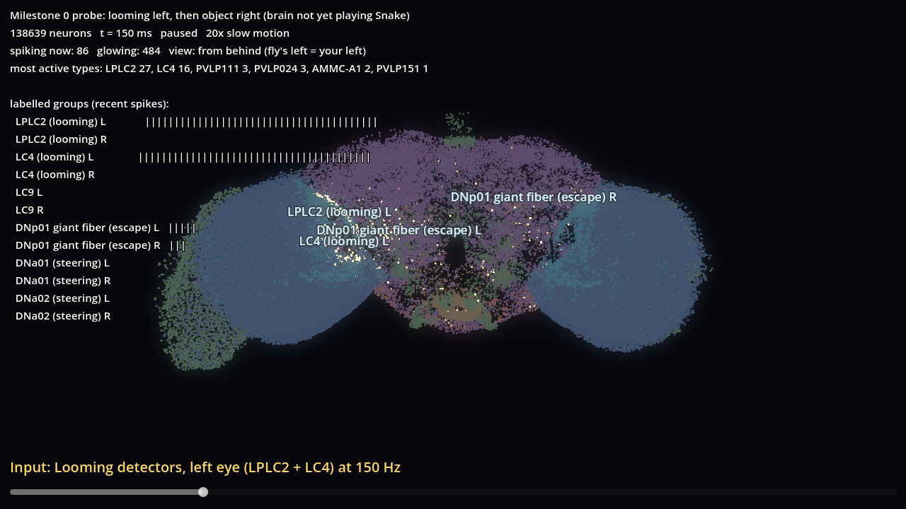

# Progress and next steps

Snapshot at the end of the 2026-11-11 session. The full history is in [DEVLOG.md](DEVLOG.md).

## How to run it

The first-time setup is in the main README (Python environment, `scripts/fetch_data.py`). After that:

| what | how |
|---|---|
| Game replay viewer | double-click `run_viewer.bat`. It opens a greedy A\* game that traps itself. |
| Fly brain view | `run_viewer.bat --brain`, or press **B** inside the game viewer |
| A particular replay | `run_viewer.bat --replay=results\replays\stage2\astar_space_check_seed0.jsonl` |
| Back from brain to game | press **G** |
| Re-run the A\* benchmark | `python -m experiments.astar_baseline --episodes 100 --size 20` |
| Re-record brain activity | `python -m experiments.record_brain_activity` |
| All tests | `python -m pytest` (30 tests) |

On its first run, `run_viewer.bat` records the brain activity (about 30 s on the GPU). It needs Godot at `%USERPROFILE%\tools\godot-4.7.2`; set `GODOT` if it is somewhere else.

Keys are shown on screen. Press **H** to hide them.

## Done

| stage | result |
|---|---|
| 0. Simulator | Shiu et al. LIF model on FlyWire v783, GPU backend, validated against Brian2 (r = 0.97). [Report 00](RESEARCH_REPORT_00_simulator_selection.md) |
| 1. Snake core | Deterministic Python game, replays verified by re-simulation |
| 2. A\* baselines | Four planners written for this project. Greedy A\* traps itself in 100/100 games (64 food); the tail-check version gets 345. [Report 01](RESEARCH_REPORT_01_astar_baselines.md) |
| 1b. Game viewer | Godot 4.7.2 3D replay viewer: four cameras, A\* plan overlay, trap banner |
| 1c. Brain view | All 138,639 neurons at their real FlyWire positions. Neurons light up as they spike, using **real recorded model activity**. Input bar and per-group spike bars (LPLC2, LC4, LC9, giant fiber DNp01, steering DNa01/DNa02). |

### Important honesty notes
- **The fly brain is not yet playing Snake.** The brain view currently plays a recording of the Milestone 0 experiment: looming on the left eye, then an object on the right eye. Once the encoder and decoder exist, the same view will show the brain *while it plays*.
- **Each dot is one point per neuron** (FlyWire's "anchor" point on the neuron's backbone), not the neuron's full shape.
- **The model has no spontaneous activity.** The brain is dark until input arrives. That is the published model, not a bug.

### Orientation of the brain view (verified 2026-11-11)
The picture is anatomically correct, not mirrored. This was checked against landmarks in the data, not assumed:
- The antennal lobes (front of the brain) are at low z, and the Kenyon cells (back and top) are at high z and low y.
- Neurons annotated "left" have lower x.
- With the viewer's axes (+x = fly's right, +y = up, −z = front) that is a right-handed, un-mirrored frame.

View 1 looks from **behind** the fly, so its left is on your left, the same way round as the snake's own view. View 4 looks from the front. `tests/test_brain_view.py` guards this.

## Known issues
1. A2's benchmark hits the 20,000-move cap, so its food score is a lower bound.
2. The interactive controls (mouse, keys, file picker) have been checked through automated runs and screenshots, not by hand.
3. The HUD's spike bars can overlap the left optic lobe at the default zoom. Zoom or rotate if they get in the way.

## Next steps, in order

1. **Retinotopy: where each visual neuron "looks".** The eyes map space onto columns, so a left-front object should drive the LC/LPLC/T4/T5 neurons whose receptive fields are there. FlyWire provides column assignments and synapse positions. I'll derive each neuron's viewing direction from those, without inventing any. *Why:* without it, the encoder can only say "something on the left" rather than "something 30° left and getting closer".
2. **Visual encoder (stage 3).** Render the snake's-eye view of the game in Python, compute looming, motion and object features, and turn them into Poisson input rates for those neurons. It is labelled as an engineered encoder, and photoreceptor input is kept as a control.
3. **Motor decoder (stage 4).** Read the left vs right steering neurons (DNa01/DNa02) and turn them into LEFT / STRAIGHT / RIGHT. No pathfinding, no distance rules, and no A\* path given to the fly.
4. **Live link.** Python streams game frames and spikes to Godot over a WebSocket, so you watch the snake and the brain side by side as it plays. Replays will store spikes too.
5. **Make the simulator faster** (event-driven synapses, aiming for 10–50×). This is what makes evolution affordable.
6. **Evolution (stage 5).** Evolve constrained parameters (input gains, thresholds, decoder weights) and never lose the best genome. Measure learning curves over affordable budgets. 1M generations would take about 866 years on this GPU at the current speed, so we extrapolate instead.
7. **Experiments (stages 6–7).** Fly vs the A\* ladder, random, reactive and small-ANN controls at long snake lengths; self-trapping metrics; distance and evasion; 20×20 → 50×50 generalisation.

---

## Endpoint, 12 November 2026 (first full evolution run)

**Done.** Event-driven simulator (26x faster, validated), visual encoder, motor decoder, evolution loop, ANN control, and one complete 60-generation fly run (`results/evolution/fly_main/`).

**Is it evolving? Yes, then it plateaus.** Training score per 300 moves (food minus 0.5 per death):

| generation | population mean | mean food | mean deaths |
|---|---|---|---|
| 0 | -6.9 | 0.3 | 14.5 |
| 20 | 14.4 | about 17 | about 6 |
| 59 | 13.5 | 16.0 | 5.1 |

Nothing improves after about generation 20. These are training scores; the held-out evaluation (`experiments/evaluate_evolution.py`) has not been run.

**Why it stalls** (`experiments/diagnose_deaths.py`, 64 unseen games, results in `results/stage5/death_diagnosis.json`):

| per 300 moves | food | deaths | what kills it | mean length at death |
|---|---|---|---|---|
| Fly, as trained | 17.2 | 6.0 | own body 62%, wall 38% | 5.0 |
| Fly, brain reset before every move | 21.9 | 8.4 | wall 65% | 5.1 |
| Fly, 48 ms per move | 18.9 | 6.1 | own body 68% | 5.2 |
| ANN control | 22.2 | 2.5 | own body 100% | 8.5 |

1. **Every fly crash was avoidable** (a safe move existed in 384 of 384), and the snake was only 5 cells long. This is a steering failure, not self-trapping.
2. **70% of crashes are turns into an adjacent obstacle.** A 5-cell snake can only hit itself by turning the same way three times running, so the fly keeps turning after it should stop.
3. **Leftover brain activity is part of it.** Resetting the brain before each move cuts body crashes but the fly then reacts too slowly and drives straight into walls (327 of 535 deaths), although it eats more (21.9, level with the ANN).
4. **Decisions are noisy.** The same view shown to 64 fresh brains gives the same action 89% of the time on average; about half the views fall below 90%.
5. **A longer window alone does not help** (48 ms: same deaths). The champion was not evolved for 48 ms, so this is weak evidence.
6. **The 300-move budget caps food at roughly 23**, so the score cannot show growth to long lengths, and a death costs only half a food.

**Not done.** Shuffled-wiring control (cancelled before it started, because the fly setup needs fixing first), held-out evaluation, comparison with A* in full games, champion brain recording, Report 02, 50x50 generalisation.

**Next, in order.**
1. Evolve with a death penalty that matters (`--death_penalty 2`, started from the current champion with `--init_from`). Both options now exist in `experiments/evolve.py`.
2. Reduce decision noise and carry-over: evolve the window length, or read out from the second half of the window only. Test each against the diagnosis above.
3. Train on full games instead of 300 moves so length can grow.
4. Richer vision: several directions per eye and a body/wall distinction. No planning.
5. Only then: shuffled-wiring control, held-out evaluation, A* comparison, Report 02.

---

## Endpoint, 15 November 2026 (stage 5 complete)

Full write-up: [RESEARCH_REPORT_02_evolution.md](RESEARCH_REPORT_02_evolution.md).

- **Best setup:** `fly_v5_regular_late12` (death penalty 2, steering read from the last 12 of 24 ms, evenly spaced input spikes). Held-out: 18.0 food and 3.7 deaths per 300 moves; evolved beats un-evolved on 64 of 64 unseen games; same result at dt 0.1 ms.
- **Controls:** ANN 22.0 food / 2.6 deaths; hand-written reflex 17.1 / 0.4; random 0.7 / 4.6.
- **Shuffled wiring:** visual input never reaches the steering neurons (0 spikes against about 145), so evolution cannot start.
- **Full games:** fly 4.5 food per game, A0 greedy A* 61.7. The fly dies at about 7 cells, so the long-length comparison with A* is not reachable yet.
- **Champion viewable:** `run_viewer.bat --brain=results/brain/fly_champion` (game minimap plus every spike).

**Next, in order:** train on full games with a length bonus; richer vision (several directions per eye, body vs wall); per-neuron gains; degree-preserving wiring control; repeat seeds; 50×50 test.

---

## Endpoint, 16 November 2026 (stage 6 complete)

Full write-up: [RESEARCH_REPORT_03_body_vision.md](RESEARCH_REPORT_03_body_vision.md).

- **Body-vs-wall vision + food-per-life scoring** (3 seeds): 13–15 food, 1.3–2.3 deaths per 300 unseen moves. Fewer deaths than stage 5 (3.3) but less food (18.0). Stage 5 champion is still the best fly on food − 0.5 × deaths.
- **Separation test** (new vision, old scoring): 16.7 food, 2.3 deaths. Vision alone removes about 1 death; per-life scoring removes about 0.5 more and costs about 2.5 food.
- **Still a steering failure:** 95–98 % of crashes avoidable, length at death 7–9.
- **Full games:** fly 8.6 food (stage 5: 4.5), ANN 36.2, greedy A* 61.7. **50×50:** fly 9.5, ANN 69.0, reflex 68.7.
- **ANN with the new vision** self-traps in 94 % of full-game deaths, so the A* long-length comparison can now be run with the ANN.

**Next, in order:** per-neuron gains and more readout types; average several brain samples per decision; A* long-length comparison with the ANN; degree-preserving wiring control.

## Endpoint, 18 November 2026 (stage 7 complete)

Full write-up: [RESEARCH_REPORT_04_learning.md](RESEARCH_REPORT_04_learning.md).

- **Added:** dopamine three-factor plasticity on 62,261 Kenyon cell → MBON synapses (FlyWire DAN → MBON map; food drives PAM, crashes drive PPL1), smell (6 glomeruli), mushroom-body vision (8 types), 72 ms readout (6.6 spikes per decision, was 2.1).
- **Calibration (disclosed, stage 7 only):** spike-frequency adaptation + Kenyon cell threshold +8 mV, chosen by the user, to stop an olfactory lock-up in the published model. Costs the old stage 5 champion 17.4 → 13.7 food, hence a matched control.
- **Learning vs matched no-learning control:** unseen games 20.3 / 2.33 vs 19.7 / 1.73 (food / deaths per 300 moves); full games 7.8 vs 8.8 (paired difference −0.9, CI −3.2 to +1.3); 50×50 17.7 vs 15.3 (+2.4, CI −1.2 to +6.1). **No measurable benefit from learning.** Same champion with learning switched off: food 20.2 vs 19.8 (paired −0.34, CI −0.84 to +0.16), although about 930 synapses per brain weaken by more than 10 % during play.
- **Both beat stage 6** (16.7 / 2.3), so the gain is from readout, smell and extra vision. ANN with smell: 21.4 / 0.41; 23.4 per full game.
- **Still a steering failure:** 99–100 % of crashes avoidable, death at about 9 cells; decisions now consistent (97–98 %).
- **Compute note:** generations took 13–17 min on a quiet machine and about 50 min while Ollama and game launchers ran (17 Nov, 8 am–9 pm); stuck `remember` plugin hook scripts were also cleaned up.

**Next, in order:** make the mushroom body matter to steering (MBON readout gains in the decoder, or punishment delivered at the moment of the bad turn); repeat seeds for learn vs control; A* long-length comparison with the ANN; degree-preserving wiring control.

## Endpoint, 20 November 2026 (stage 8 complete, final learning trial)

Full write-up: [RESEARCH_REPORT_05_move_feedback.md](RESEARCH_REPORT_05_move_feedback.md).

- **Added:** per-move dopamine (danger ahead drives PPL1, closer to food drives PAM; engineered shaping, disclosed) and an MBON readout (35 FlyWire types, one weight each). Pre-test: learning could flip up to 90 % of moves.
- **Learning vs matched no-learning control, full games:** 20x20 6.7 vs 8.9 food (paired -2.2, CI -4.3 to -0.2); 50x50 9.4 vs 16.8 (-7.4, CI -10.9 to -4.1). **Learning made play worse.**
- **Unseen games (300 moves):** learn 19.0 / 2.03, control 20.1 / 1.89 (food / deaths); neither improved on its starting genome.
- **Evolution set the danger (punishment) drive to 0 Hz** in the learning champion.
- **Still a steering failure:** 97-100 % of crashes avoidable, death at 8-9 cells.
- **Conclusion:** the fly can be evolved to play Snake poorly but not well with this interface; within-life learning does not help; the long-length A* comparison is out of reach.
- Not done: repeat seeds; same-champion learning on/off ablation for stage 8.
