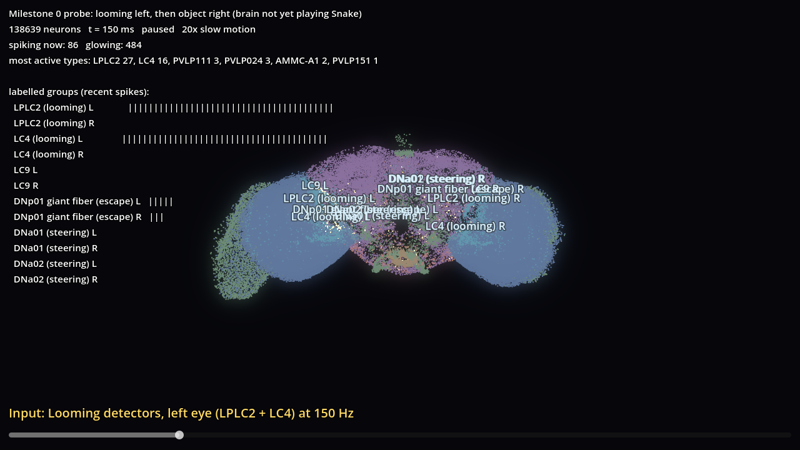

# Progress and next steps

Snapshot at the end of the 2026-11-10 session. The full history is in [DEVLOG.md](DEVLOG.md).

## How to run it

The first-time setup is in the main README (Python environment, `scripts/fetch_data.py`). After that:

| what | how |
|---|---|
| Game replay viewer | double-click `run_viewer.bat`. It opens a greedy A\* game that traps itself. |
| Fly brain view | `run_viewer.bat --brain`, or press **B** inside the game viewer |
| A particular replay | `run_viewer.bat --replay=results\replays\stage2\astar_space_check_seed0.jsonl` |
| Back from brain to game | press **G** |
| Re-run the A\* benchmark | `python -m experiments.astar_baseline --episodes 100 --size 20` |
| Re-record brain activity | `python -m experiments.record_brain_activity` |
| All tests | `python -m pytest` (28 tests) |

On its first run, `run_viewer.bat` records the brain activity (about 30 s on the GPU). It needs Godot at `%USERPROFILE%\tools\godot-4.7.2`; set `GODOT` if it is somewhere else.

Keys are shown on screen. Press **H** to hide them.

## Done

| stage | result |
|---|---|
| 0. Simulator | Shiu et al. LIF model on FlyWire v783, GPU backend, validated against Brian2 (r = 0.97). [Report 00](RESEARCH_REPORT_00_simulator_selection.md) |
| 1. Snake core | Deterministic Python game, replays verified by re-simulation |
| 2. A\* baselines | Four planners written for this project. Greedy A\* traps itself in 100/100 games (64 food); the tail-check version gets 345. [Report 01](RESEARCH_REPORT_01_astar_baselines.md) |
| 1b. Game viewer | Godot 4.7.2 3D replay viewer: four cameras, A\* plan overlay, trap banner |
| 1c. Brain view | All 138,639 neurons at their real FlyWire positions. Neurons light up as they spike, using **real recorded model activity**. Input bar and per-group spike bars (LPLC2, LC4, LC9, giant fiber DNp01, steering DNa01/DNa02). |

### Important honesty notes
- **The fly brain is not yet playing Snake.** The brain view currently plays a recording of the Milestone 0 experiment: looming on the left eye, then an object on the right eye. Once the encoder and decoder exist, the same view will show the brain *while it plays*.
- **Each dot is one point per neuron** (FlyWire's "anchor" point on the neuron's backbone), not the neuron's full shape.
- **The model has no spontaneous activity.** The brain is dark until input arrives. That is the published model, not a bug.

## Known issues (next session)
1. The brain-view labels overlap when zoomed out, so they are off by default (press **L**).
2. The silent-neuron colours are bright enough to compete with the firing glow. Tune them, or start in fade mode (**F**).
3. **Check left/right orientation.** The screenshot labels make it look possibly mirrored (the viewer may be looking from behind the brain). It must be verified against FlyWire's axes before any figure is published.
4. A2's benchmark hits the 20,000-move cap (food score is a lower bound).
5. The interactive controls have only been checked through automated runs and screenshots, not by hand.

## Next steps, in order

1. **Fix the brain-view issues above** (small).
2. **Retinotopy: where each visual neuron "looks".** The eyes map space onto columns, so a left-front object should drive the LC/LPLC/T4/T5 neurons whose receptive fields are there. FlyWire provides column assignments and synapse positions. I'll derive each neuron's viewing direction from those, without inventing any. *Why:* without it, the encoder can only say "something on the left" rather than "something 30° left and getting closer".
3. **Visual encoder (stage 3).** Render the snake's-eye view of the game in Python, compute looming, motion and object features, and turn them into Poisson input rates for those neurons. It is labelled as an engineered encoder, and photoreceptor input is kept as a control.
4. **Motor decoder (stage 4).** Read the left vs right steering neurons (DNa01/DNa02) and turn them into LEFT / STRAIGHT / RIGHT. No pathfinding, no distance rules, and no A\* path given to the fly.
5. **Live link.** Python streams game frames and spikes to Godot over a WebSocket, so you watch the snake and the brain side by side as it plays. Replays will store spikes too.
6. **Make the simulator faster** (event-driven synapses, aiming for 10–50×). This is what makes evolution affordable.
7. **Evolution (stage 5).** Evolve constrained parameters (input gains, thresholds, decoder weights) and never lose the best genome. Measure learning curves over affordable budgets. 1M generations would take about 866 years on this GPU at the current speed, so we extrapolate instead.
8. **Experiments (stages 6–7).** Fly vs the A\* ladder, random, reactive and small-ANN controls at long snake lengths; self-trapping metrics; distance and evasion; 20×20 → 50×50 generalisation.
