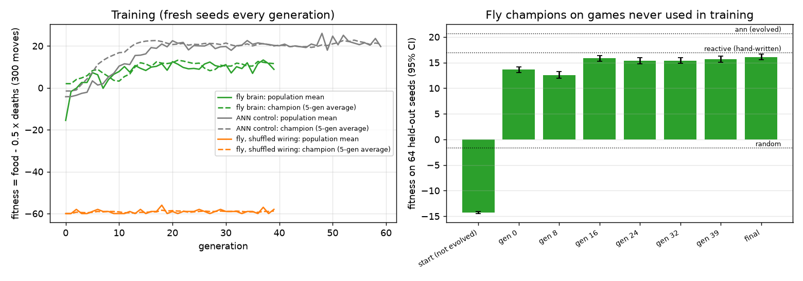

# Research Report 02: evolving an interface to the FlyWire connectome

*FlySnake3D, stages 3–5. Written 15 November 2026.*

## Question

Can evolution find an input/output interface that lets the unmodified FlyWire
connectome play Snake? If so, how well does it play compared with an ordinary
neural network, a hand-written reflex and the A* baselines of Report 01, and
does the specific wiring matter?

## Short answer

- **Evolution works.** Every evolved champion beats the un-evolved starting
  interface on games never used in training (all 64 of 64 held-out games
  improved; mean +30 fitness).
- **The fly plays like a beginner.** It eats about 18 food per 300 moves with
  about 3.7 deaths. The small neural network control eats 22 with 2.6 deaths, a
  four-rule hand-written reflex eats 17 with 0.4 deaths, and greedy A* eats 62
  food in a single game where the fly eats 4.5.
- **The real wiring is required.** On shuffled wiring, visual input never
  reaches the steering neurons at all, so evolution makes no progress.
- **The original hypothesis (beating A* at long lengths) could not be tested.**
  The fly never gets long enough to self-trap: only 1 of 64 full games ended in
  a self-trap death.

## Setup

| part | what it is |
|---|---|
| Brain | FlyWire FAFB v783, 138,639 neurons, Shiu et al. 2024 LIF model, never modified. Event-driven simulator at dt 0.6 ms (checked against dt 0.1 ms below). |
| Vision | 6 features per eye (obstacle side, diagonal and front; looming ahead; food side and front), mapped by evolved gains onto 8 visual projection neuron types (LPLC2, LC4, LPLC1, LC6, LC16, LC9, LC10a, LC11), lateralised by FlyWire `side`. |
| Steering | Left-minus-right spike counts of 5 descending neuron types (DNa01, DNa02, DNa03, DNg13, DNp09), weighted by evolution; turn if above an evolved threshold. No pathfinding, no rules. |
| Genome | 54 numbers (48 gains, 5 weights, 1 threshold). |
| Evolution | Diagonal Gaussian ES, population 64, champion never lost, common random numbers. Each candidate plays 300 moves with restarts. |

## What was tried, and why

The first full run (`fly_main`, 60 generations, death penalty 0.5) improved
quickly and then stalled at about 17 food and 6 deaths per 300 moves. A
diagnosis on unseen games (`experiments/diagnose_deaths.py`) showed:

- every crash was avoidable (a safe move existed in 384 of 384);
- the snake was only about 5 cells long when it died, so this is a steering
  failure, not self-trapping;
- 70% of crashes were turns into an adjacent obstacle (over-turning);
- the same view shown to 64 freshly reset brains gave the same action only 89%
  of the time.

Each setting below was then evolved, starting from the `fly_main` champion, and
diagnosed on the same 64 unseen games:

| run | change | food / 300 moves | deaths / 300 moves | length at death |
|---|---|---|---|---|
| `fly_main` | baseline (penalty 0.5) | 17.2 | 6.0 | 5.0 |
| `fly_v2_penalty2` | death costs 2 food | 16.9 | 4.7 | 5.5 |
| `fly_v3_late12` | + count steering spikes only in the last 12 of 24 ms | 17.8 | 4.2 | 6.1 |
| `fly_v4_win36_late12` | + 36 ms window (stopped at generation 13) | 17.9 | 5.3 | 5.5 |
| **`fly_v5_regular_late12`** | + evenly spaced input spikes instead of Poisson | **18.0** | **3.3** | **6.8** |
| ANN control | — | 22.2 | 2.5 | 8.5 |

`fly_v5` is the best setup and the one evaluated below. Two caveats:

- **Not like-for-like:** v2–v5 had more total evolution than `fly_main` (they
  continued from its champion), and `fly_v2` and `fly_v4` were cut short when
  the computer slept.
- **Regular input deviates from the published model:** Shiu et al. use Poisson
  input. The mean input rate is unchanged; only its spike-count randomness is
  removed.

Decision agreement stayed near 0.83 in every variant, regular input included.
So the remaining variability comes from the brain's own state and the random
phase of each input train, not from the input noise alone.

A matched run from scratch with the v5 settings (`fly_v5_scratch`, 40
generations) reached only about 15 food and 5 deaths. With a harsh death penalty
from the start, the population spends its early generations learning to avoid
dying rather than to eat. Starting from a champion evolved with a mild penalty
worked better.

## Results on held-out games

All numbers below come from 64 games never used in training (seeds
500000–500063, 300 moves, the same rules for every controller), with 95%
bootstrap intervals. Fitness here is food − 0.5 × deaths for every controller,
so they are comparable.

| controller | fitness | food | deaths | longest snake |
|---|---|---|---|---|
| Fly, not evolved | −14.3 | 0.7 | 30.0 | 4 |
| **Fly, evolved (`fly_v5`)** | **16.1** [15.5, 16.6] | **18.0** [17.4, 18.5] | **3.7** | **17** |
| Fly, evolved, re-run at dt 0.1 ms | 16.0 [15.4, 16.6] | 17.8 | 3.7 | 16 |
| Fly, shuffled wiring, evolved | −14.3 | 0.7 | 30.0 | 4 |
| Fly champion's genome on shuffled wiring | −14.3 | 0.7 | 30.0 | 4 |
| Random | −1.6 | 0.7 | 4.6 | 5 |
| Hand-written reflex | 17.0 [16.0, 17.8] | 17.1 | 0.4 | 27 |
| ANN, evolved | 20.7 [20.1, 21.3] | 22.0 | 2.6 | 26 |

- **Evolution generalises:** the final champion beats the starting interface on
  all 64 held-out games (mean +30.4 fitness, 95% CI [29.8, 31.0]).
- **The coarse time step is safe:** re-running the champion at the published dt
  of 0.1 ms gives the same result (16.0 against 16.1).
- **The fly is not yet competitive:** it finds food about as well as the
  hand-written reflex but dies about nine times as often, and trails the ANN on
  both food and deaths.

### Full games, A* benchmark rules (seeds 0–63)

| controller | food per game | steps | how games ended | self-trap deaths |
|---|---|---|---|---|
| Fly, evolved | 4.5 [3.8, 5.3] | 74 | body 40, wall 24 | 2% |
| ANN, evolved | 6.9 [5.7, 8.1] | 88 | body 63, wall 1 | 2% |
| Hand-written reflex | 29.7 [25.6, 33.9] | 686 | body 37, starved 26, wall 1 | 59% |
| Random | 0.2 | 62 | wall 63 | 0% |
| A0 greedy A* | 61.7 | 974 | body 57, wall 7 | 100% |
| A2 A* + tail check | 346.2 | 19,473 | step cap 59 | 5% |

In a single game the fly lasts about 74 moves and eats 4–5 food. That is
consistent with the 300-move numbers (about 4 food per life). It dies long
before the snake is long enough to trap itself, so the comparison this project
set out to make (fly against A* at long lengths, where greedy A* self-traps)
is not reachable yet.

## Does the specific wiring matter?

The shuffled control keeps every neuron's outgoing synapses, strengths and
signs but gives each neuron's inputs to a random other neuron. Driving every
visual input neuron at 200 Hz for 240 ms (`experiments/shuffled_reach_probe.py`,
3 seeds):

| wiring | neurons that fire | total spikes | spikes in the steering neurons |
|---|---|---|---|
| real | about 4,100 | about 100,000 | 143–150 |
| shuffled | about 5,860 | about 121,000 | **0** |

The shuffled brain is more active overall, but none of that activity reaches the
descending neurons the decoder reads. The shuffled fly therefore always goes
straight, every candidate scores the same, and evolution has nothing to select
on. This shows that the FlyWire visual-to-descending pathways are what make
steering possible here.

It is a weak control in one sense: it shows the wiring is *necessary*, not that
the real wiring is *better* than another network that does connect vision to
the readout. A degree-preserving rewiring that keeps some vision-to-readout
paths would be the stronger test.

## Limitations

- **Coarse vision:** the visual input is engineered features, not retinotopic
  images. The fly cannot tell its own body from a wall and has no view of the
  board layout.
- **Few knobs:** evolution tunes 54 numbers around a fixed brain. The ANN
  control has 131 free weights and no spiking noise, so the ANN result is an
  upper reference, not a like-for-like comparison.
- **Short training games:** the 300-move budget caps food at roughly 23 and
  never rewards growing long.
- **Small budgets:** each setting was evolved once (one seed), for 13–60
  generations. Differences of about one death per 300 moves between v2, v3 and
  v4 may not survive repeats.
- **Unchecked citations:** the decoder readout neurons and their roles were
  chosen from memory of the literature. The citations still need checking.
- **No generalisation test:** the 50×50 board has not been tried.

## What would most likely help next

1. **Train on full games** (or a much longer budget) with a length bonus, so
   evolution rewards growing long.
2. **Richer vision:** several directions per eye, and a body-versus-wall
   distinction carried by different visual populations. Still no planning.
3. **More interface freedom without touching the connectome:** per-neuron rather
   than per-type gains, or more readout types.
4. **A stronger wiring control:** degree-preserving rewiring that keeps some
   vision-to-readout paths.
5. **Repeats:** several seeds per setting before ranking the v2–v5 variants.

## Files

- Runs: `results/evolution/{fly_main, fly_v2_penalty2, fly_v3_late12, fly_v4_win36_late12, fly_v5_regular_late12, fly_v5_scratch, fly_v5_shuffled, ann_main}/`
- Diagnosis: `results/stage5/death_diagnosis*.json`
- Evaluation: `results/stage5/evaluation.json`, `results/stage5/episodes.csv`
- Wiring probe: `results/stage5/shuffled_reach_probe.json`
- Champion replay: `results/replays/stage5/fly_champion_seed0.jsonl`
- Champion brain recording: `results/brain/fly_champion/` (open with `run_viewer.bat --brain=results/brain/fly_champion`)
