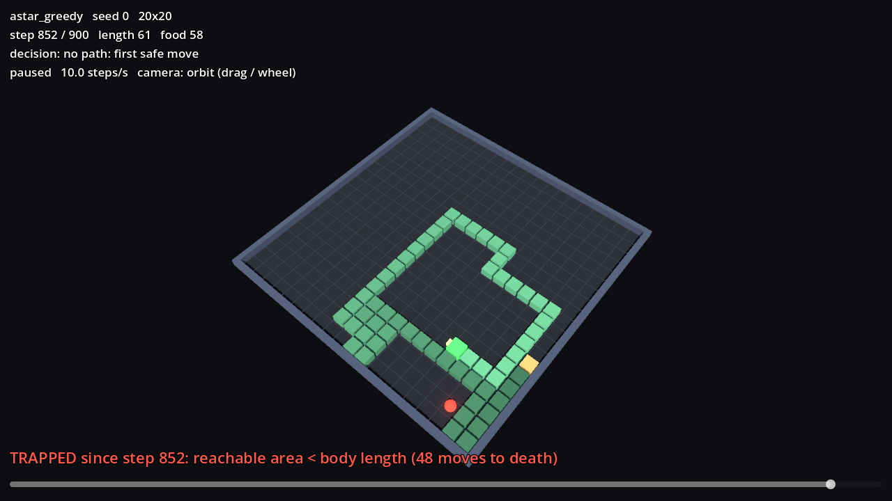
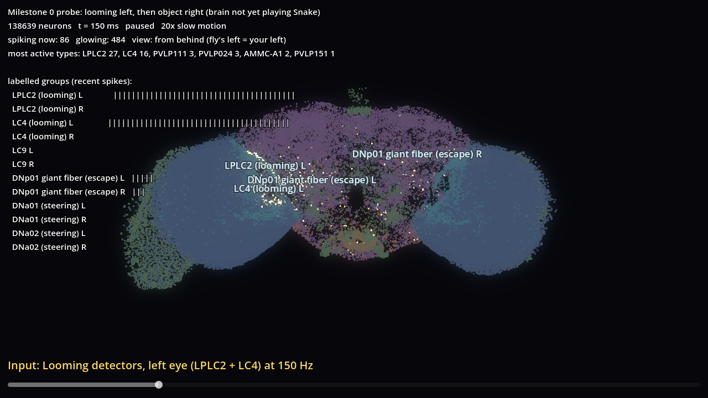

# Replay viewer (Godot 4.7)

A 3D viewer for the replays written by `game/runner.py`. **Python is authoritative.** The viewer only draws recorded frames; it never simulates or changes the game.



## Run

Godot 4.7.2 (standard build, not mono): download it from <https://godotengine.org/download>. On the dev machine it is at `C:\Users\User\tools\godot-4.7.2`.

```bash
Godot_v4.7.2-stable_win64.exe --path viewer -- --replay=<absolute path to .jsonl>
```

Leave out `--replay` and press **O** to pick a file.

| key | action |
|---|---|
| Space | play / pause |
| ← / → | step one move |
| ↑ / ↓ | double / halve speed |
| Home / End | first / last frame |
| T | jump to the first trapped state |
| 1 2 3 4 | camera: orbit (drag, wheel) / top-down / chase / head position |
| O | open a replay |
| H | toggle help |

What you see:
- **Head:** the green box; its nose shows the heading.
- **Body:** darkens towards the tail; the tail tip is amber.
- **Food:** red.
- **Planned path:** cyan dots, recorded by the A\* agents only.
- **Trap warning:** a red banner from the first state where the reachable area is smaller than the body (see report 01).

The head camera sits roughly at the snake's eye position. It is **not** the fly's visual input, which is built by the encoder in Python.

## Brain view

`run_viewer.bat --brain` from the project root, or press **B** in the replay viewer (**G** goes back). It draws all 138,639 neurons at their FlyWire anchor positions and lights each one when it spikes, from a recording made by `experiments/record_brain_activity.py`.



| key | action |
|---|---|
| Space, ← / →, ↑ / ↓, Home | play, step 2 ms, speed, restart |
| 1 2 3 4 | view from behind / above / the right side / the front |
| drag, wheel | rotate, zoom |
| F | fade silent neurons |
| L | labels (each appears only while its group is firing) |

View 1 is from behind, so the fly's left is on your left. The orientation is verified against anatomical landmarks (see `docs/PROGRESS_AND_NEXT_STEPS.md`).

The brain is not yet connected to the game. The recording is the Milestone 0 stimulus experiment.

## Automation

```bash
# validate a replay and draw every frame, no window
Godot_v4.7.2-stable_win64_console.exe --headless --path viewer -- --replay=<file> --check
# render one frame to a PNG (needs a GPU / window)
Godot_v4.7.2-stable_win64_console.exe --path viewer -- --replay=<file> --screenshot=out.png --frame=trap --cam=1
```

`tests/test_viewer.py` runs the `--check` mode. It is skipped if Godot is not installed (set `GODOT` to the console executable).

## Not done yet
- Live view of running games (WebSocket from Python).
- The brain view playing alongside a game, once the brain is connected.
- Smooth interpolation between moves. Frames are shown discretely so what you see is exactly what was recorded.
